# 개발 과정: 설계 → 목업 → 코드

기준일: 2026-11-19.

## 먼저 밝혀 둘 것

이 프로젝트는 **코드를 먼저 만들고 문서와 목업을 나중에 정리**했습니다. 첫 커밋(2026-11-05)부터 앱 코드가 들어 있고, 코드 이전에 그린 목업 기록은 없습니다. 아래 목업은 "이미 만든 화면을 설계도처럼 정리한 것"이며 처음부터 있었던 것처럼 쓰지 않습니다.

멘토 피드백(기획 → TO DO → 설계(목업 포함) → 코드, 코드는 항상 마지막)을 받은 뒤부터는 이 순서를 규칙으로 지킵니다. 목업은 HTML 파일 하나만 고치면 되므로, 코드 여러 파일을 고치는 것보다 수정이 쉽고 비용도 적습니다.

## 1. 설계는 이렇게 되어 있습니다

| 문서 | 무엇을 보여 주나 |
|---|---|
| [요구사항 정의서](requirements.md) | 무엇을 만드는가 (기능 24개, 품질 8개, 인수 시나리오 8개) |
| [시스템 아키텍처](system-architecture.md) | 자료 수집 → 빌드 → 정적 배포 → 브라우저 실행 흐름 |
| [MVC 역할 설계](mvc-design.md) | 화면(View), 컨트롤러, 자료(Model)가 맡는 일과 실제 파일 대응 |
| [프로젝트 설계서](project-design.md) | 자료 모델, 검색·상세 처리, 화면 설계, 오류·보안 설계 |

구조도:

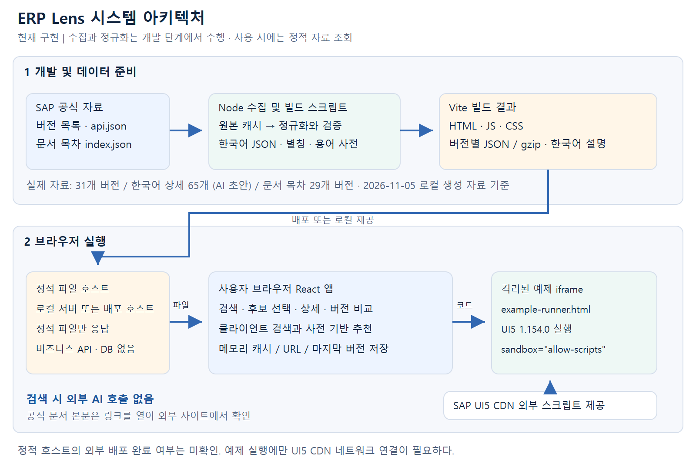

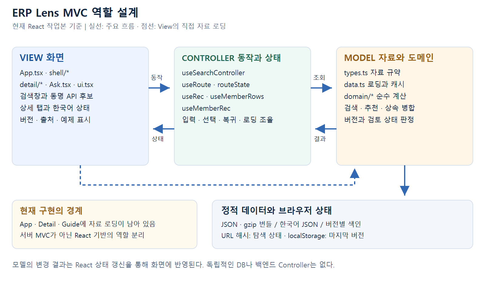

## 2. 목업 (화면 설계도)

원본은 [`mockups/screens.html`](mockups/screens.html) 한 파일입니다. 화면 구조를 바꾸고 싶으면 이 파일만 고치고, 이미지는 `npm run docs:mockups`로 다시 만듭니다. 각 목업 아래 주황색 줄은 그 화면의 설계 의도입니다.

**1. 첫 화면 (UI5 탭)**

<picture><source media="(prefers-color-scheme: dark)" srcset="assets/mockups/01-home-dark.png">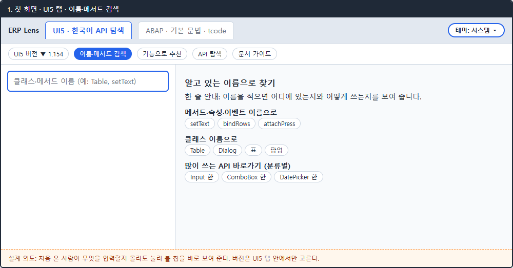</picture>

**2. 검색 결과와 API 상세**

<picture><source media="(prefers-color-scheme: dark)" srcset="assets/mockups/02-detail-dark.png">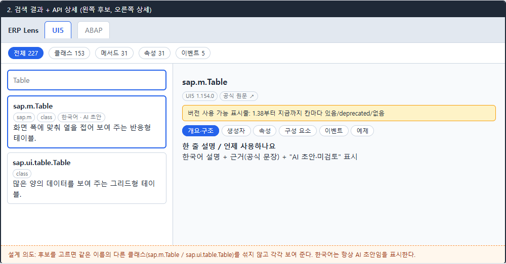</picture>

**3. ABAP 문법 사전**

<picture><source media="(prefers-color-scheme: dark)" srcset="assets/mockups/03-abap-syntax-dark.png">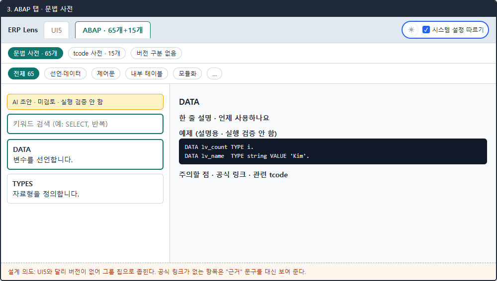</picture>

**4. tcode 사전**

<picture><source media="(prefers-color-scheme: dark)" srcset="assets/mockups/04-abap-tcode-dark.png">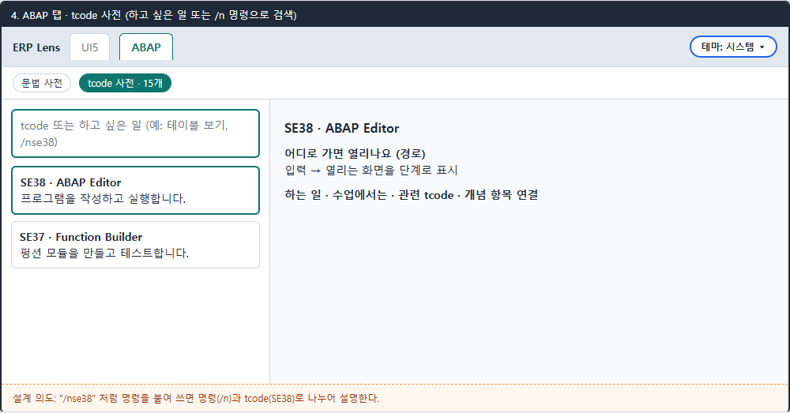</picture>

**5. 화면 모드 선택 (라이트·다크)**

<picture><source media="(prefers-color-scheme: dark)" srcset="assets/mockups/05-theme-toggle-dark.png">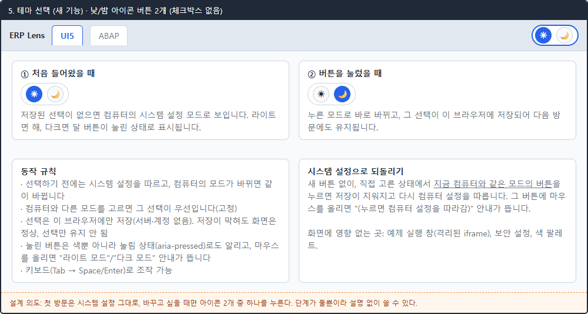</picture>

이 기능은 L08 순서(기획 → TO DO → 목업 → 코드)로 만든 첫 사례입니다. 목업을 세 번 고친 뒤(콤보박스 → 체크박스+아이콘 → 아이콘 2개) 코드를 썼습니다. 목업 수정 이력은 커밋 기록에 있습니다.

## 3. 실제로 만들어진 화면

같은 화면을 구현한 결과입니다 (2026-11-19 캡처, `npm run docs:screens`, 보는 사람의 라이트·다크 모드에 맞춰 이미지가 바뀝니다). 목업보다 정보가 많습니다. 구조와 흐름이 목업과 같은지 비교해 보세요.

<picture><source media="(prefers-color-scheme: dark)" srcset="assets/screens/01-home-dark.png">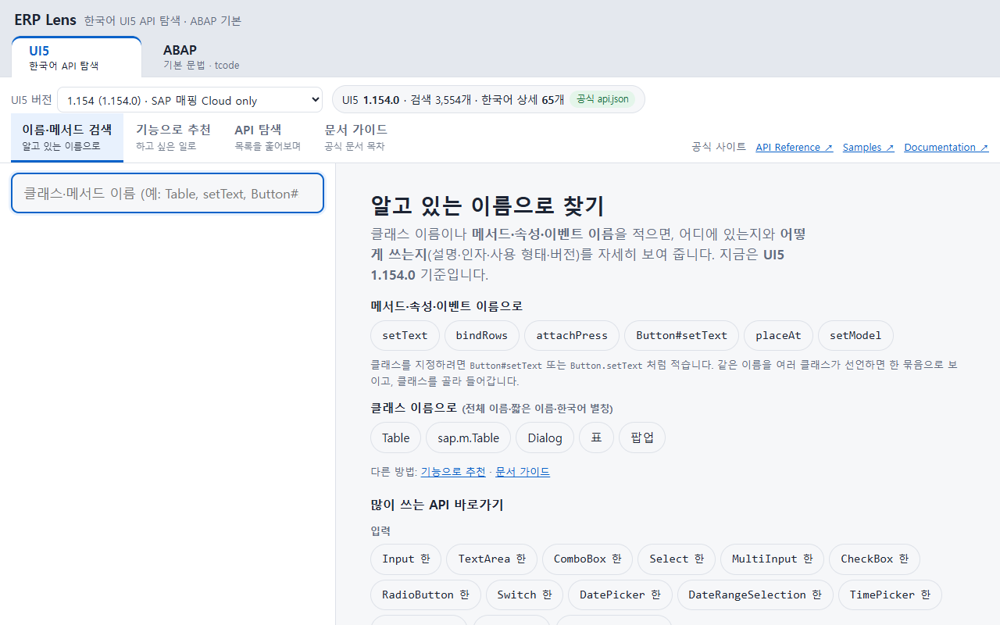</picture>

<picture><source media="(prefers-color-scheme: dark)" srcset="assets/screens/03-detail-dark.png">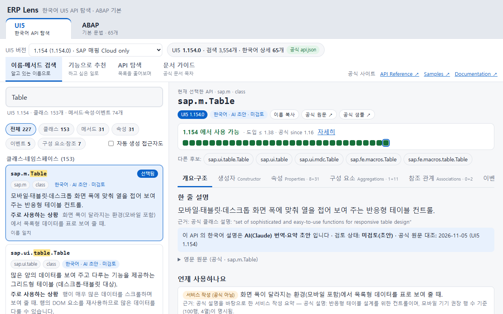</picture>

<picture><source media="(prefers-color-scheme: dark)" srcset="assets/screens/04-abap-syntax-dark.png">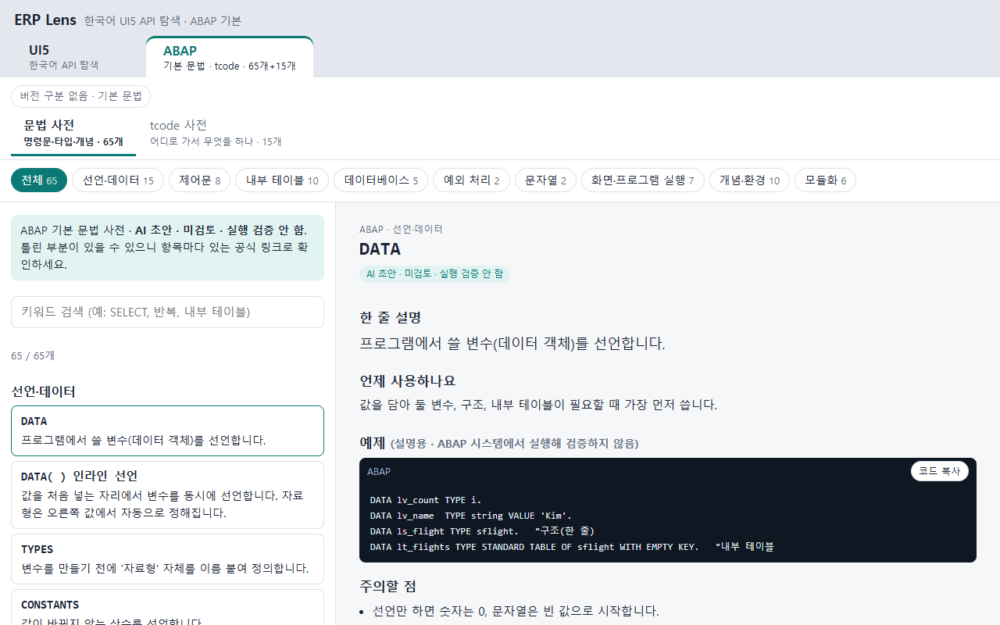</picture>

<picture><source media="(prefers-color-scheme: dark)" srcset="assets/screens/05-abap-tcode-dark.png">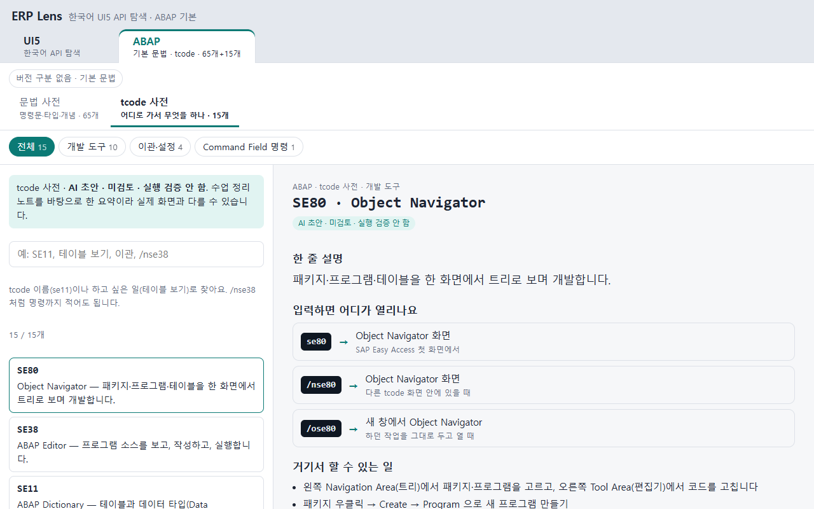</picture>

## 4. 코드 개발 흐름

커밋 기록(40개)을 단계로 묶었습니다. 각 단계는 단위 테스트와 E2E로 확인했습니다 ([테스트 문서](testing.md)).

| 날짜 | 단계 | 한 일 |
|---|---|---|
| 11-05 | **1. 첫 구현** | UI5 31개 버전의 공식 `api.json` 수집, 이름 검색, 한국어 설명 층, 기능 추천 |
| 11-05 | 2. 다듬기 | 통합 검색창, 첫 화면, 버전 한눈에 보기, 라이브러리 이름 검증, 보안 강화, 구조 정리 |
| 11-06 | 3. 확장 | 탐색 모드 4개(이름·추천·API 탐색·문서 가이드), 멤버 상세, 실패 구분, 프로젝트 문서 |
| 11-06~09 | 4. 추천 개선 | 추천표와 작은 분류기, 독립 평가 데이터로 정확도 측정·공개, 시작 화면 바로가기 |
| 11-09 | 5. 한국어 | 인기 API 65개 한국어 설명, 자동 번역 캐시(영문 설명 첫 문장) |
| 11-10 | 6. ABAP 추가 | ABAP 기본 탭(문법 사전 33개), 이름 검색에서 ABAP 항목 안내, 앱 이름을 ERP Lens로 변경 |
| 11-13 | 7. 구조 개편 | 상단 탭(UI5 / ABAP), tcode 사전, 개념·환경 그룹 |
| 11-14~19 | 8. ABAP 보강 | 수업 노트 기반으로 문법 65개, tcode 15개로 확장, 모듈화 그룹, 보안 점검 강화 |
| 11-19 | 9. 화면 모드 | 라이트·다크 선택 버튼(첫 방문은 시스템 설정, 컴퓨터와 같은 모드 버튼을 누르면 시스템 따르기로 복귀), 문서 이미지를 라이트·다크 두 벌로 교체. 기획 → TO DO → 목업 → 코드 순서로 진행한 첫 기능 |

검증 숫자 (2026-11-19): 타입 검사 통과, 단위 테스트 111개 통과, E2E 161개 통과, ABAP 항목·링크 점검 80개 통과.

## 5. 앞으로의 개발 순서

새 기능이나 화면 변경은 아래 네 단계를 모두 거치며, 단계마다 결과를 확인받고 다음으로 넘어갑니다. 코드는 마지막에만 씁니다.

```text
1 기획 → 2 TO DO → 3 설계 + 목업(HTML 1파일) → 4 코드 개발 → 테스트(단위, E2E)
  왜?     무엇을    화면 구조를 그림으로     목업과 같게 구현
          어떤 순서로  먼저 확인·승인
```

| 단계 | 결과물 | 승인 기준 |
|---|---|---|
| 기획 | 무엇을 왜 만드는지 한 문단 | 방향이 맞는가 |
| TO DO | 해야 할 일 목록과 순서 | 범위가 맞는가 |
| 설계 + 목업 | `docs/mockups/screens.html`에 화면 추가, 설계 문서 갱신 | 화면 구조가 맞는가 |
| 코드 개발 | 목업과 같은 구현, 테스트 통과 | 목업과 실제 화면이 같은가 |
