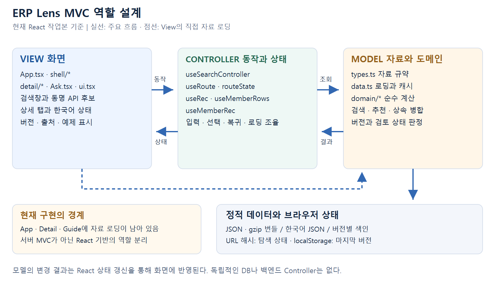

# ERP Lens MVC 역할 설계

구현 확인 기준일: 2026-11-05

ERP Lens는 React 컴포넌트와 훅을 사용하여 화면, 상호작용 제어, 자료 및 도메인 로직을 나눈다. 고전적인 서버 MVC 프레임워크를 사용한 구현은 아니며, MVC의 책임 구분을 클라이언트 구조에 대응한 설계이다.

## 구조도

[벡터 원본 SVG](assets/mvc-design.svg)

## 역할과 구현 위치

| 역할 | 구현 위치 | 책임 |
| --- | --- | --- |
| View | `src/App.tsx`, `src/shell/`, `src/detail/`, `src/Ask.tsx`, `src/ui.tsx` | 검색창, 후보 목록, 상세 탭, 출처·버전·한국어 상태 및 예제를 표시하고 사용자 동작을 전달한다. |
| Controller | `src/controller/useSearchController.ts`, `route.ts`, `routeState.ts`, `useRec.ts`, `useMemberRows.ts`, `useMemberRec.ts` | 입력 디바운스, URL 상태, 후보 선택과 복귀, 키보드 처리, 검색·추천 자료 로딩을 조율한다. |
| Model | `src/types.ts`, `src/data.ts`, `src/domain/`, 정적 JSON | 데이터 규약, 자료 로딩과 캐시, 검색·추천·상속 병합·버전 상태·한국어 검토 상태 계산을 담당한다. |

## 주요 상호작용

1. 사용자가 View의 검색창에 `Table`을 입력한다.
2. Controller가 입력을 디바운스하고 URL 검색 상태를 갱신한다.
3. Model의 검색 함수가 선택 버전의 인덱스와 한국어 별칭을 사용해 후보를 계산한다.
4. View가 정식 이름과 용도를 포함한 후보 목록을 표시한다.
5. 후보 선택으로 API 상태가 바뀌면 상세 자료와 부모 체인, 한국어 해설을 조회한다.
6. 조회 결과와 검토 상태가 React 상태를 통해 화면에 반영된다.

## 도메인 로직의 분리

| 모듈 | 역할 |
| --- | --- |
| `domain/search.ts` | 이름·별칭 검색과 후보 순위 |
| `domain/memberIndex.ts` | 멤버 이름 검색, 종류 필터, 선언 클래스 그룹 |
| `domain/recommend.ts`, `memberRecommend.ts` | 공식 말뭉치와 용어 사전 기반 추천 |
| `domain/members.ts`, `hierarchy.ts` | 상속 관계와 멤버 병합 |
| `domain/life.ts` | 버전별 존재·도입·deprecated 상태 해석 |
| `domain/ko.ts` | 한국어 설명의 없음·초안·검토·재검토 상태 |
| `domain/topics.ts` | 문서 목차 탐색 |

도메인 함수는 화면과 네트워크에 직접 의존하지 않도록 구성되어 브라우저 없이 단위 테스트할 수 있다.

## 현재 분리 수준과 개선 방향

`App.tsx`는 전역·버전 자료를, `detail/Detail.tsx`는 상세 자료를 직접 불러온다. `shell/Guide.tsx` 내부에도 목차 로딩 훅이 있다. 따라서 모든 View가 표시만 담당하는 엄격한 분리 상태는 아니다.

향후 필요하면 로딩 책임을 전용 Controller 훅으로 옮길 수 있다. 이는 개선 제안이며, 현재 코드에 이미 반영된 구조로 설명하지 않는다.

관련 문서: [시스템 아키텍처](system-architecture.md), [프로젝트 설계서](project-design.md)
