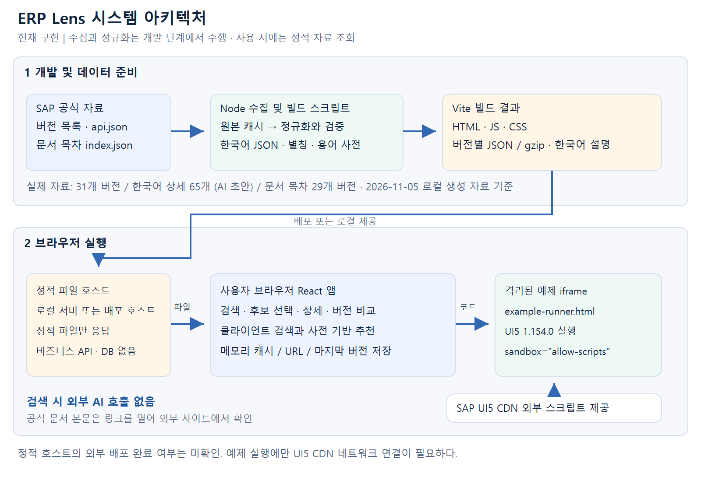

# ERP Lens 시스템 아키텍처

구현 확인 기준일: 2026-11-05

ERP Lens는 개발 단계에서 자료를 준비하고, 사용자의 브라우저에서 검색·추천·상세 탐색을 수행하는 정적 웹앱이다. 현재 비즈니스 API 서버, 사용자 데이터베이스, 실시간 AI 추론 서버는 사용하지 않는다.

## 구성도

[벡터 원본 SVG](assets/system-architecture.svg)

## 구성 요소

| 요소 | 역할 | 실행 시점 |
| --- | --- | --- |
| 공식 자료 출처 | 버전 목록, 라이브러리 API 메타데이터, 문서 목차 제공 | 개발 환경의 자료 수집 |
| Node 스크립트 | 자료 수집, 정규화, 참조 검증, 색인·버전 가용성 생성 | 개발 및 갱신 |
| 한국어 설명 데이터 | 한국어 요약, 사용 조건, 예제, 출처와 검토 상태 | 콘텐츠 관리 및 빌드 |
| Vite 빌드 | 앱 코드와 정적 데이터의 배포물 생성 | 빌드 |
| 정적 호스트 | HTML, JavaScript, CSS, JSON, gzip 파일 제공 | 사용자 접속 |
| React 앱 | 검색·추천·후보 선택·상세·버전 비교 | 사용자 브라우저 |
| 예제 iframe | 문서 탐색 영역과 분리된 실행 결과 제공 | 예제 실행 버튼 선택 |
| UI5 CDN | 예제에서 필요한 UI5 런타임과 모듈 제공 | 예제 실행 |

정적 호스트는 배포 가능한 구성이다. 기준일의 점검은 로컬 정적 서버에서 수행했으며 외부 배포 완료 여부는 확인하지 않았다.

## 자료 준비 흐름

1. `discover-versions.mjs`로 버전 목록과 자료 제공 범위를 확인한다.
2. `fetch-api.mjs`로 API 자료와 출처 manifest를 캐시한다.
3. `fetch-topics.mjs`로 공식 문서 목차를 수집한다. 문서 본문은 수집하지 않는다.
4. `build-data.mjs`로 API 모델, 이름·멤버 색인, 추천 말뭉치와 가용성 자료를 생성한다.
5. 한국어 설명이 참조하는 API·멤버와 기준 해시를 검증하고 예제 검증 기록을 연결한다.
6. 타입 검사와 테스트를 거쳐 앱을 빌드한다.

공식 API의 사실 데이터와 서비스가 작성한 한국어 설명은 분리하여 관리한다.

## 사용자 실행 흐름

1. 앱 시작 시 전역 버전 목록·가용성·별칭을 불러온다.
2. 선택한 버전의 인덱스를 로드한다.
3. 이름 검색은 브라우저에서 계산하며, 멤버·추천 색인은 필요한 시점에 로드한다.
4. API를 선택하면 해당 라이브러리 번들, 부모 체인, 한국어 설명을 조합한다.
5. 문서 가이드에서는 목차를 탐색하고 공식 사이트의 본문으로 이동한다.
6. 예제 실행 시에만 격리된 iframe에서 UI5 런타임을 사용한다.

## 저장과 통신 경계

- 정적 JSON과 gzip 번들이 런타임 자료 저장 역할을 한다. 데이터베이스를 조회하는 별도 서버 API는 없다.
- Promise 기반 캐시는 브라우저 메모리에 존재한다.
- URL 해시는 탐색 상태를 표현하고, localStorage에는 마지막 선택 버전을 저장한다.
- 기능 추천은 공식 말뭉치와 용어 사전으로 계산한다. 검색 요청마다 생성형 AI를 호출하지 않는다.
- 앱 본체와 예제 실행 문서는 서로 다른 콘텐츠 보안 정책을 적용한다.
- 외부 배포에서는 자료 파일 제공과 응답 헤더의 실제 적용을 별도로 검증해야 한다.

## 데이터 갱신과 서비스 범위

기준일에 생성된 자료는 31개 UI5 버전이며, 문서 목차는 29개 버전에 있다. 이는 수집 시점의 범위이며 모든 역사적 UI5 버전을 지원한다는 뜻이 아니다. 한국어 상세 설명과 검토 범위는 [구현 현황](implementation-status.md)에 별도로 기록한다.

관련 구현: `scripts/`, `src/data.ts`, `src/domain/`, `public/example-runner.html`, `vite.config.ts`.
